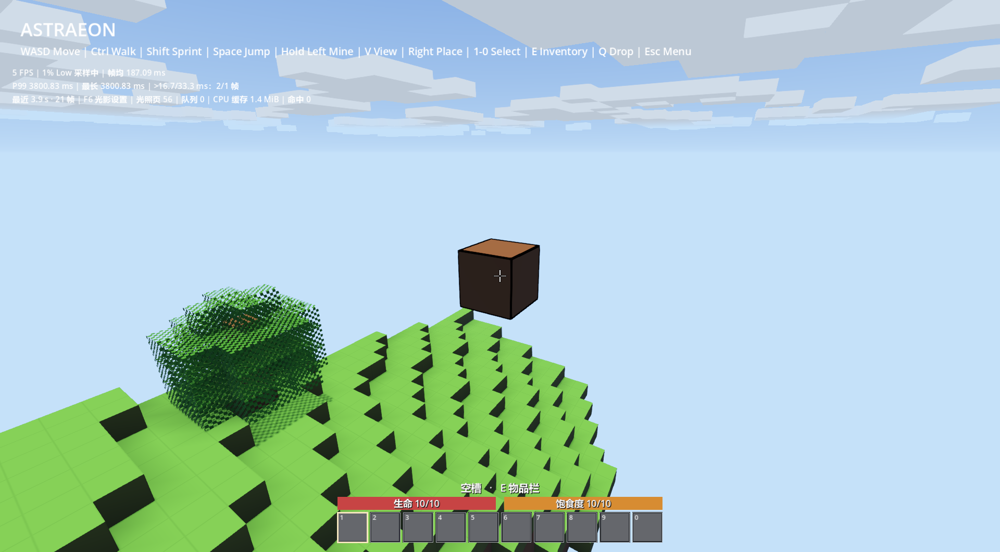
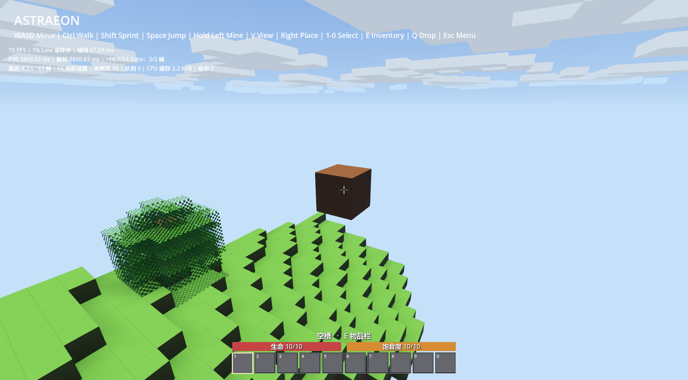

# 准星方块黑线边框

2026-09-27，Godot 4.7，Forward+ / D3D12，main 实际渲染。只进行功能检查，不进行性能测试；截图中的启动期 HUD 数字不是性能结果。没有原生 DLL 改动或用户存档修改。

| 检查 | 结果 | 证据 |
| --- | --- | --- |
| 主世界射线选取和选中框 | 15 项，0 失败，退出 0 | [日志](block_target_verified.log) |
| 主世界挖掘事务回归 | 14 项，0 失败，退出 0 | [日志](target_mining_regression.log) |
| 编辑器脚本检查 | native_world、block_target 有效，无诊断；错误控制台 0 条 | MCP 已核实 ASTRAEON 及本 checkout 路径 |

选取覆盖负坐标、同一网格复用、目标 ID、释放鼠标、输入禁用、暂停、8m 以外、水体、移除方块、看向天空及重新瞄准。挖掘回归直接推进生产控制器，验证累计/取消/切换/完成编辑掉落及保存；不宣称操作系统鼠标自动化手感验收。

## 画面

开启：



关闭对照：



已检查：目标与准星一致；可见轮廓和面边界为黑线，盒体内部保持原材质；背面的边线没有透过实体正面。网格外扩 0.002m，Shader 按屏幕导数绘制约 2px 边带，不投影、不写深度，保留深度测试。不同面相接和斜视时视觉宽度会略有变化；本轮未增加玩家设置菜单。

## 复现与限制

```text
godot --path . --script res://test/content/gdscript/test_block_target.gd
godot --path . --script res://test/content/gdscript/test_mining_progress.gd
```

按 AGENTS 记录任务进程身份并使用项目 tmp 输出。测试自动创建独立世界，不读取或删除玩家存档。为保持固定截图，测试关闭角色物理并将测试相机移出 SpringArm；正式相机装配未改动。

首次功能检查通过，但方块靠近海面影响画面观察。将测试移到高处后发现 SpringArm 重置相机导致两次截图阶段 selection restored 断言失败，固定测试相机后最终全部通过。中间失败不是生产边框通过证据。

日志仍含系统根证书读取失败、第三方 MCP 注册器 AppData 写入被拒绝以及 Godot Shader 磁盘缓存 f.is_null 错误；未出现脚本解析/执行或 Shader 编译错误。没有删除缓存、提权或终止用户进程。报告保留原始日志而不隐去环境错误。

源指纹见 [fingerprints.json](fingerprints.json)。正式行为契约见 [方块外观](../../../../docs/shading/block_appearance.md#准星目标边框)。
