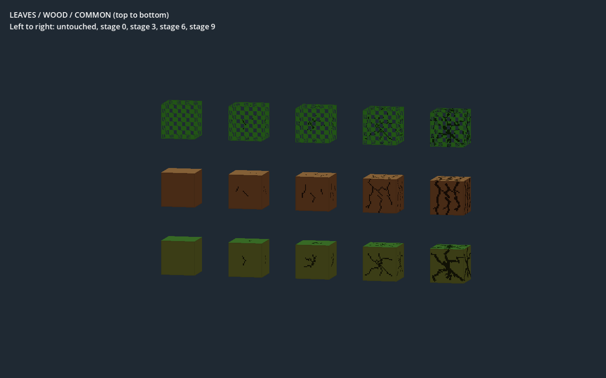

# 阶段裂纹与生存挖掘验证

日期：2026-09-27。Godot 4.7，Windows，图形检查使用项目 Forward+ / D3D12。编译器 aeb-content-1.3。未修改原生 DLL；测试使用描述文件当前指向的 5f41c0ca42db 二进制。代码/内容包 SHA-256 见 [fingerprints.json](fingerprints.json)。本报告为功能验证，不含性能测试或性能承诺。

## 结果

| 检查 | 结果 | 证据 |
| --- | --- | --- |
| 原版两组十阶段裂纹、共享缓存、逐阶段参数、负坐标、清除引用、错误条带拒绝、实际 Shader | 27 检查，0 失败，退出 0 | [日志](breaking_render_final.log) |
| main 生存挖掘：累计、取消、换目标、完成删除/掉落、保存 | 14 检查，0 失败，退出 0 | [日志](mining_progress_final.log) |
| 内容包编解码、损坏检查、确定性和载荷读取回归 | 26 检查，0 失败，退出 0 | [日志](breaking_codec.log) |
| 24 朝向、六面 UV 与共享回归 | 74 检查，0 失败，退出 0 | [日志](breaking_orientations.log) |
| 原版包重新构建 | 成功，15082 字节，7 个唯一载荷 | [日志](breaking_builtin_deploy.log) |
| 光影样板夹具、SDK 示例包重新构建 | 成功 | [样板](breaking_shading_pack.log)、[示例](breaking_sdk_example.log) |

共 141 项断言通过。codec/orientation 独立夹具显式禁用裂纹，保持其纯色与六面图集的原测试边界；新裂纹行为由 test_breaking 单独验证。部署校验通过 43 项源文件收据。SDK 重新生成（24 个输入文件），未重新执行独立 SDK 冷导入。

通过已验证的 Astraeon 编辑器刷新文件，等待扫描完成；MCP script_check 对进度和裂纹 Resource 返回有效、无诊断，编辑器错误控制台为 0。未另开编辑器或冷导入。

## 画面对照



从上到下：树叶、木材、通用；从左到右：未挖掘、阶段 0、3、6、9。观察到两组纹理形态不同，裂纹随阶段扩展，树叶原始孔洞保持透明。截图来自原生 mesher 生成的网格和生产 Shader；独立复制材质仅用于同屏展示不同进度，不用于生产地形。测试镜头关闭反射专用层，避免相机默认可见层触发反射标记路径。

main 功能测试实例化真实世界，在独立 tmp 世界上手动推进同一个生产挖掘控制器，不模拟操作系统鼠标事件。覆盖进度到事务提交和保存；持续真实鼠标操作的手感仍需人工评估。创造即时挖掘路径保留。工具倍率、多人目标、非立方体裂纹不在本轮范围。

## 调试记录与环境限制

首次裂纹检查发现资源属性写在 script 之前导致组未加载、生成图片未严格保留前阶段像素，以及测试使用了未暴露的网格 API；均已修复后重跑。首个 main 测试缺少当前 world.cfg，被正确拒绝，且临时运行器帧数上限使其提前退出；它不是通过记录。最终测试改用正式 WorldSelection 创建世界，并使用有身份记录的进程超时保护。

最终独立进程日志仍包含系统根证书读取错误、第三方 MCP 注册器写 AppData 被权限拒绝；图形检查另有 Godot shader cache 文件写入 f.is_null 错误。没有脚本解析/执行错误或 Shader 编译错误，完成标记和退出码均已检查。没有为了清理这些环境信息删除缓存、提权、修改第三方路径或终止用户进程。

## 复现

遵循根 AGENTS 的编辑器/进程规则，分别启动并记录身份：

```text
godot --path . --script res://test/content/gdscript/test_breaking.gd
godot --path . --script res://test/content/gdscript/test_mining_progress.gd
godot --headless --path . --script res://test/content/gdscript/test_codec.gd
godot --headless --path . --script res://test/content/gdscript/test_orientations.gd
```

要求退出 0、对应 DONE 标记及 failures=0，同时单独分析 ERROR 日志。测试世界、运行日志和 SDK 产物写入项目 tmp；报告只保留本次证据。
