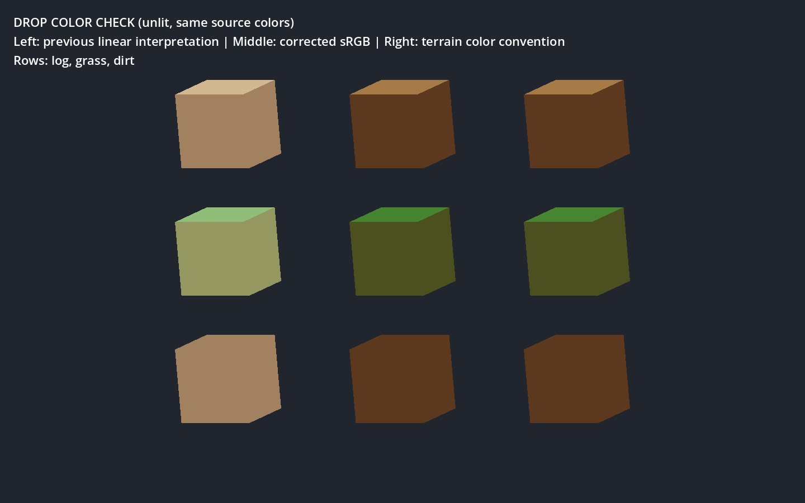

# 掉落物偏白检查与修正

2026-09-27，Godot 4.7 / Forward+ / D3D12。测试调用生产 `_cube_mesh`，使用原版编译包的原木、草、泥土六面颜色。无存档、掉落物事务或原生 DLL 修改，未运行性能测试。

原因：纯色掉落物直接使用 sRGB 制作值作为顶点色，材质的 vertex_color_is_srgb 默认 false，按线性亮度解释；地形 pack_colors 为 source_color uniform，会正确转线性。修正启用顶点色 sRGB 解码，不修改源色、曝光或光照强度。依据 [Godot BaseMaterial3D](https://docs.godotengine.org/en/stable/classes/class_basematerial3d.html#class-basematerial3d-property-vertex-color-is-srgb)。

## 实际渲染

左：旧行为；中：修正后的生产掉落网格/材质；右：与地形相同的 source_color 六面颜色解释。各行依次为原木、草块、泥土。为了隔离色彩空间，三列使用无光照材质，不将此图当作真实世界昼夜/洞穴受光验收。

14 项检查通过，退出 0，见 [完整日志](drop_colors_fixed.log)。修正列与参考列三种材质的中心采样最大通道差约 1/255，来自顶点色量化；旧列显著偏亮。比如泥土中心旧值约 (0.6314, 0.5059, 0.3765)，修正为 (0.3569, 0.2196, 0.1176)，参考为 (0.3608, 0.2196, 0.1216)。图集分支顶点色为白，不受这次转换影响。

首次测试因项目 UI 缩放使相机投影坐标与输出图片尺寸不一致，出现采样越界与错误比较；测试关闭窗口内容缩放后重跑通过。最终日志无脚本/Shader 编译错误，仍含根证书读取失败、第三方 MCP AppData 写入拒绝及 Godot Shader 磁盘缓存 f.is_null；没有绕过权限或清缓存。MCP 核实编辑器名称和本 checkout 路径，生产脚本检查通过。

当前掉落物仍用普通 Godot 材质，不具备地形分页体素光照和全部六面表面参数。此次验证是基础颜色修正，不宣称光影完全一致。已运行的游戏需要重新启动场景以重建已缓存材质。
