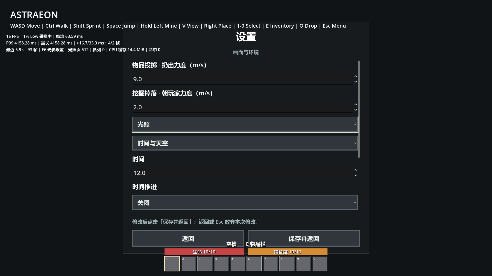

# 挖掘掉落弹跳验证

日期：2026-09-27。引擎：Godot 4.7 stable（5b4e0cb0f），Windows / D3D12 Forward+，RTX 3060 Laptop GPU。

## 实现与自动检查

生存挖掘掉落在方块中心各轴 ±0.2 m 内随机生成，水平速度各轴 -1～1 m/s，向上速度 3～4 m/s。朝玩家力度默认 0，允许 0～10 m/s，以一次水平初速度叠加，不改变向上分量。手动投掷和创造破坏规则不变。

通过已连接的 ASTRAEON 编辑器完成刷新与等待导入；编辑器错误列表为空。测试入口为 [test_throwing.gd](../gdscript/test_throwing.gd)，本次使用 tmp 下的 Node 包装场景交由同一编辑器启动，退出后读取日志：`THROWING_TEST {"checks":30,"failures":[]}`。未发现 SCRIPT ERROR、ERROR 或解析错误。

30 项检查覆盖随机偏移和速度范围、随机变化、默认力度、朝玩家方向及重合位置、真实挖掘生成记录和原生物理向上运动；同时覆盖原有手部投掷、瞄准、设置保存重读、主菜单取消／保存以及非法范围和格式拒绝。测试数据和世界写入 tmp，不修改正式存档。

## 图形检查与边界

已查看 1920×1080 设置截图：新选项标签、数值和相邻控件完整显示。截图中的力度 2 是测试保存值，默认 0 由自动检查验证。

本轮验证了实际原生运动与设置布局，未进行手动连续挖掘的手感验收，也不构成长时间压力测试或新增多分辨率验收。
