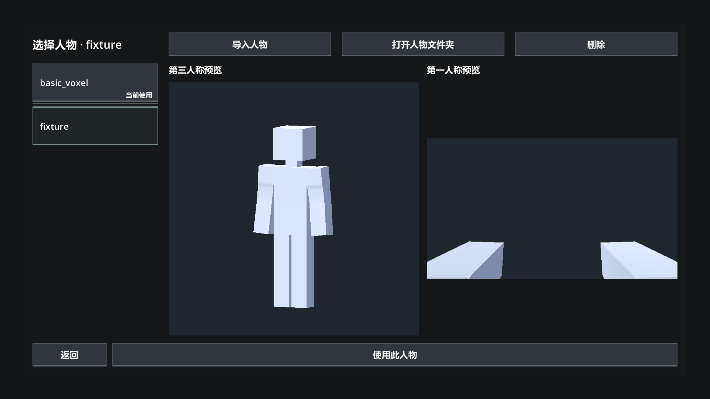
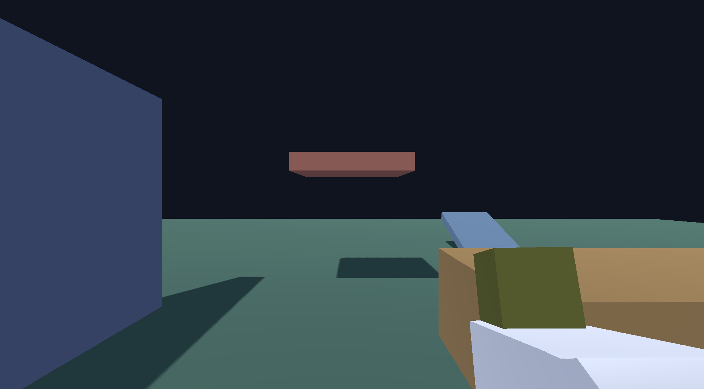
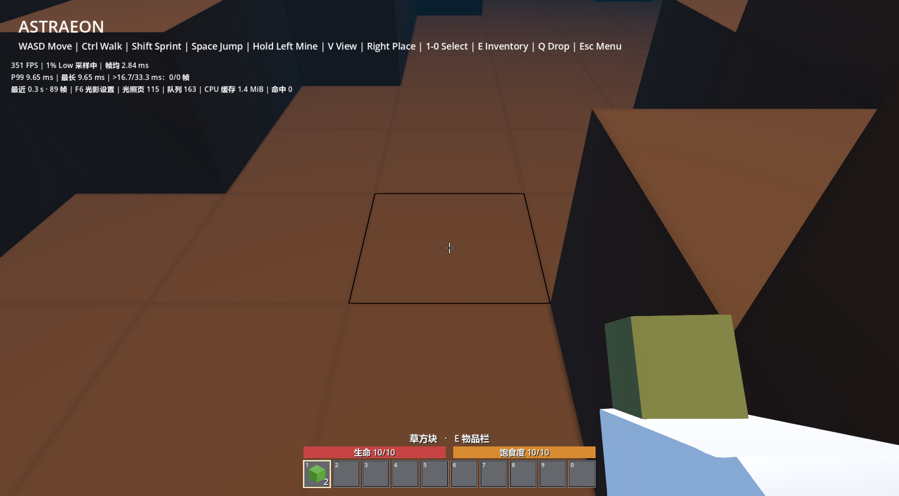

# 成对人物与独立第一人称验收

日期：2026-09-27。环境：Windows，Godot 4.7 stable，Astraeon 当前工作区（含尚未提交的内容包与库存集成）。状态：通过本轮针对性检查。

默认人物安装为 external_data/characters/basic_voxel/basic_voxel_tp.glb 与 basic_voxel_fp.glb；来源、尺寸和哈希见 [资源规范](../../../docs/resource_specifications.md#标准来源与文件)。外部文件按项目规则不提交 Git，复现前须安装这对模型。

使用图形引擎 `--path <项目> --fixed-fps 60 --resolution 1920x1080 --script <入口> --log-file <项目>/tmp/<日志>`。测试使用 tmp 内配置、人物副本与世界，未替换正式设置或存档。

| 入口 | 结果 | 临时日志 |
| --- | --- | --- |
| test/ui/gdscript/character_import_smoke.gd | 16 项通过 | paired_import.log |
| test/ui/gdscript/character_select_check.gd | 59 项通过 | paired_menu.log |
| test/entities/gdscript/test_first_person_body.gd | 28 项通过 | paired_views.log |
| test/entities/gdscript/test_held_block.gd | 22 项通过 | paired_held.log |
| test/entities/gdscript/test_world_held_block.gd | 5 项通过 | paired_world.log |

共 130 项通过，退出码均为 0，无 SCRIPT ERROR / ERROR。导入覆盖成对校验、同内容重复导入、缺 FP 拒绝、旧平铺文件拒绝、单个按钮、成对删除与保留来源。菜单布局检查覆盖 1920×1080、2560×1440、3840×2160、3440×1440。视角覆盖 FP 相机挂载与独立动画、TP 显隐、切换、移动和跳跃；持物覆盖独立 Grip_R、FP_HoldBlock_R、视角显隐及主世界闭环。

实际查看 1920×1080 菜单、第一人称平视与主世界截图，确认双预览和手臂／0.12 m 方块显示。其余尺寸为自动布局检查，不等同于逐项人工视觉验收。尚未验收持物贴墙、穿模规避、长期游戏与全部服装变形；本轮未重跑完整历史物理测试。

