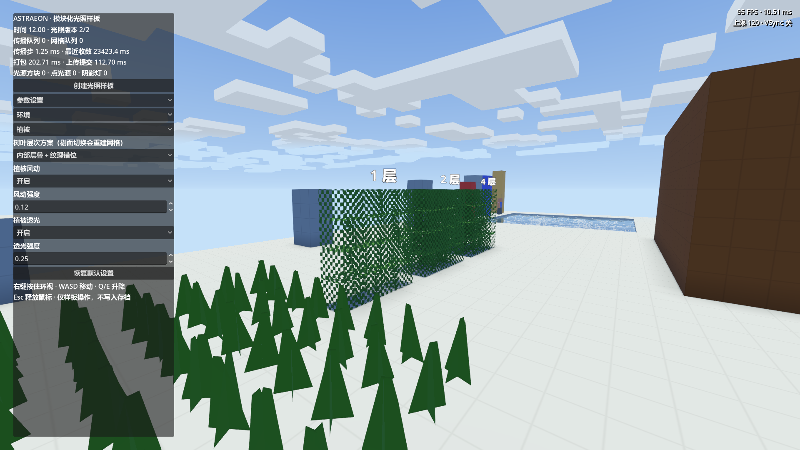

# 可配置方块面分辨率

日期：2026-09-27。状态：已实现；不含性能基准。

BlockAppearance.texture_resolution 默认/建议 32，允许 1–1024 整数。六面统一 N，编译颜色/ORM/常量自发光图为 6N×N；树叶纹理错位使用 textureSize 得到实际像素尺寸。原木方向回归测试从实际图集读取面尺寸，不再假设 16。体素尺寸、section、逻辑状态 ID 与地图格式未变，未增加磁盘缓存。

## 验证

Godot 4.7.stable.official.5b4e0cb0f，Forward+ / D3D12。验证使用本项目已部署的原生扩展，无需 DLL 重建。

```powershell
& 'F:/Godot_v4.7-stable_win64.exe/Godot_v4.7-stable_win64.exe' --path 'F:/GodotProjects/Astraeon' --log-file 'F:/GodotProjects/Astraeon/tmp/atlas-resolution/run.log' --script res://test/shading/gdscript/test_atlas_resolution.gd -- --visual
& 'F:/Godot_v4.7-stable_win64.exe/Godot_v4.7-stable_win64.exe' --headless --path 'F:/GodotProjects/Astraeon' --log-file 'F:/GodotProjects/Astraeon/tmp/atlas-resolution/landscape.log' --script res://test/world/gdscript/test_landscape.gd
```

- 图集与继承的树叶/主世界网格切换检查：FOLIAGE_DONE checks=93 failures=0，exit 0；[断言列表](2026-09-27_atlas_resolution/checks.md)。
- 分辨率覆盖 1、8、16、32、48、64、128；验证六面颜色、粗糙度、相对发光值、旋转、源图重采样与 UV 旋转。非法 0、负数、1025 被资源校验拒绝。未分配最大 1024 的图集做压力测试。
- 原生世界内容/原木方向/生成及临时存档测试：checks=22，failures=[]，exit 0。
- 实机截图为默认 32 面分辨率，三个树叶层次模式与风动 shader 均实际绘制。未单独对每个特殊分辨率做实机叶片截图。
- MCP 已确认 ASTRAEON 和本 checkout 路径，编辑器完成扫描，错误输出为空。独立验证进程仍有操作系统证书/MCP 注册写入警告，图形进程有 shader 磁盘缓存写入错误；无脚本或 shader 编译错误。



像素数量变化不会给低分辨率源图凭空增加细节；棋盘叶片的莫尔纹仍存在。图集中不同朝向状态尚未去重，无磁盘合成缓存；内存估算见 [图集生命周期](../../../docs/shading/block_appearance.md#图集编译与缓存)，非本轮实测 VRAM。
