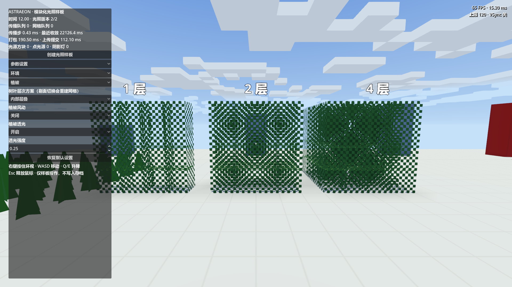
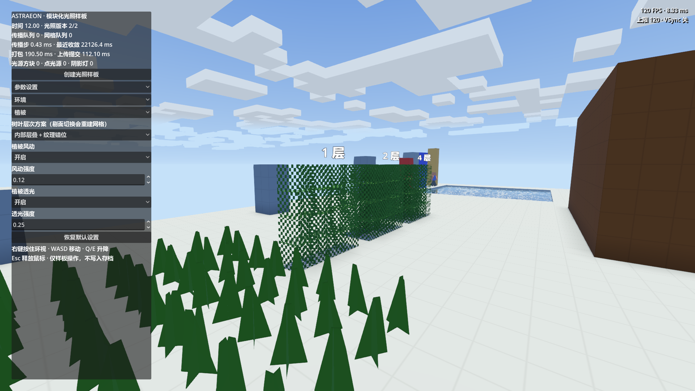

# 树叶透光规则统一验证

日期：2026-09-27。状态：已实现并完成逻辑和短时渲染检查；不包含性能基准。

## 变更与范围

正式树叶定义已有 light_opacity = 1，原生 game/shading/native/cache/section_light_cache.h 已支持定义驱动的阻光与发光。旧样板则仅允许 AIR 传播和参与 GPU 插值，测试树叶定义默认阻光 15，导致叶孔后及邻接表面死黑。

样板现在读取测试 catalog 对应定义；shading_test_leaves 显式阻光 1。直射天空光扣目标格 opacity，邻接传播扣 max(1, opacity)，方块光源读取 light_emission；GPU B 通道对 opacity < 15 标记为可采样。源资源不被运行时修改。正式世界 C++ 求解器未改动，无 DLL 重编译。

有限样板仍是测试专用 GDScript 参考求解器，正式世界仍是 C++ section 缓存。此轮核对了原生公式与采样打包规则，并测试样板结果；未声称运行了整个正式流式世界的逐格数值对照。

## 验证

Godot 4.7.stable.official.5b4e0cb0f；渲染检查为 1920×1080、正午、默认样板环境，固定 FPS 上限 120。进程自行退出，exit 0。

```powershell
& 'F:/Godot_v4.7-stable_win64.exe/Godot_v4.7-stable_win64.exe' --headless --path 'F:/GodotProjects/Astraeon' --log-file 'F:/GodotProjects/Astraeon/tmp/leaf-light/logic.log' --script res://test/shading/gdscript/test_light_volume.gd
& 'F:/Godot_v4.7-stable_win64.exe/Godot_v4.7-stable_win64.exe' --path 'F:/GodotProjects/Astraeon' --log-file 'F:/GodotProjects/Astraeon/tmp/leaf-light/visual.log' --script res://test/shading/gdscript/test_foliage_layers.gd -- --visual
```

| 检查 | 结果 |
| --- | --- |
| 有限光场增量结果与独立全量 flood oracle | LIGHT_VOLUME PASS checks=99 failures=0 |
| 1/2/4 层完整叶顶、负坐标、石顶替换与拆除 | 叶顶下分别 14/13/11；石顶 0，移除后 15 |
| 密闭石管内光源穿过一格树叶 | 叶格 14，下一空气格 13；移除光源后归零，无天空漏光 |
| 定义驱动 | opacity 3、emission 7 的独立配置得到叶格 4、下一格 3；共享原定义不变 |
| 原生网格/主世界层次切换及样板截图 | FOLIAGE_DONE checks=59 failures=0 |
| 渲染观察 | 孔洞后及邻接地面恢复照明；保留 1/2/4 层厚度，叶层模式切换不改光照版本 |

独立进程有操作系统证书读取错误、MCP 用户注册目录写入警告，图形进程另有 shader_rd.cpp::_save_to_cache 的磁盘缓存写入错误。未发现脚本错误或着色器编译错误，但不将这些日志描述为无错误日志。编辑器文件系统已刷新并结束扫描；编辑器另记录了刷新期间的 progress dialog / tasks.has 错误，不作为成功导入的证据，当前行为验证来自上述新启动的独立测试进程。

## 截图与边界





截图 FPS/初始化耗时只是界面读数，不是本轮性能结论。棋盘测试贴图仍有莫尔纹；原生顶点 AO 未改变，接触处可能继续偏暗。树冠的逻辑减光、alpha 裁剪投影、材质背光透亮是三个独立环节。
