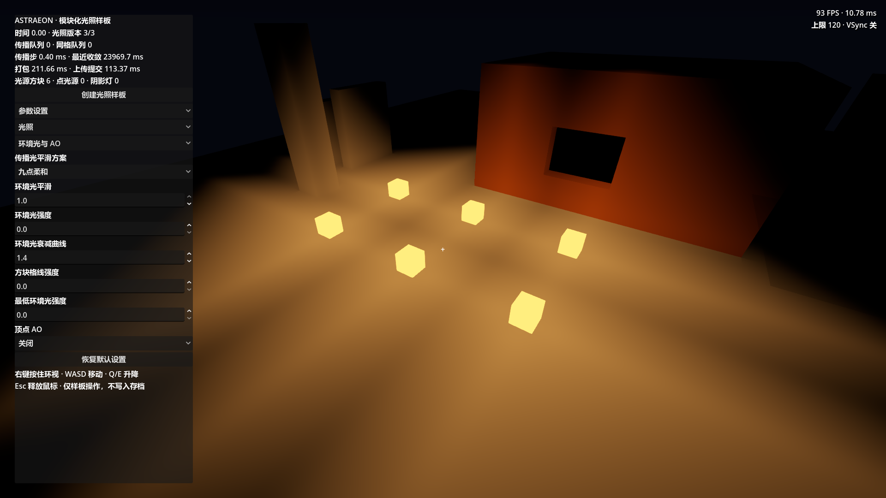
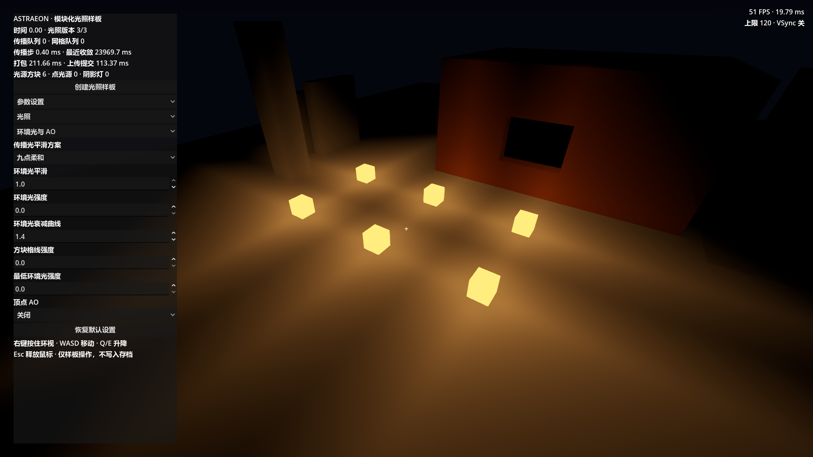
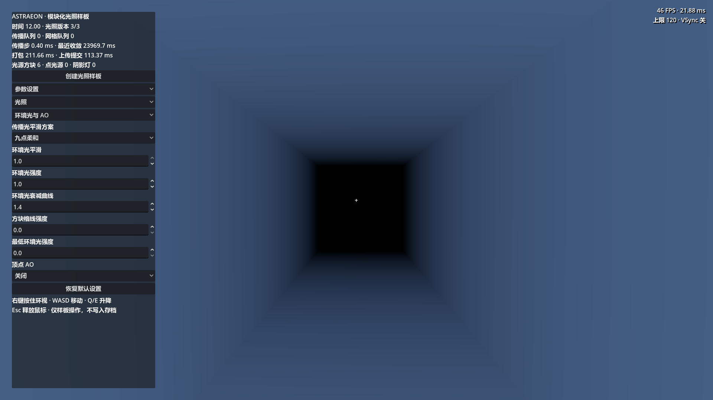

# 传播光平滑：参考与渲染验证

日期：2026-09-27。范围：显示采样、天空可见度、曲线、面板和两种场景绑定。逻辑传播与原生 DLL 未修改；不包含正式性能基准或正式流式世界完整跑图。

## 参考结论

- Minecraft 风格的平滑照明在面角处理邻近光值并在面内插值，区别于增加逻辑光级。参考 [Sodium 的 Minecraft 平滑照明实现说明](https://github.com/CaffeineMC/sodium/blob/dev/common/src/main/java/net/caffeinemc/mods/sodium/client/model/light/smooth/SmoothLightPipeline.java)：该项目明确说明了相对 vanilla 的修正，因此它是原版路线的实现参考，不能当作某个 Java 原版版本的精确参数表。没有把 Bedrock 的参数冒充 Java 原版。
- [MakeUp light_vertex.glsl](https://github.com/javiergcim/MakeUpUltraFast/blob/master/shaders/src/light_vertex.glsl) 读取 lmcoord；方块光形状为 x*sqrt(x)+(1.17*x)^6，天空光经坐标范围转换，并独立调最低环境光。查询时间为本报告日期；上游 master 会变化。
- Astraeon 现有 CPU 光值为 0–15，六邻接传播；显示为四点格心插值，方块曲线指数 1.6，环境曲线 1.4。天空直射可见度原先绕过平滑，是独立的逐格边界来源。
- 采用项目自编的表面 3×3 二次 B 样条正权重滤波；不复制 Java 或 GLSL 源码，不复刻原版 AO 特殊分支。MakeUp 风格数学曲线峰值归一；上游顶点计算和本项目片元计算的位置不同。

## 实现与默认值

默认九点柔和，天空和方块光平滑强度均 1.0；保留逐格与四点线性对照。默认保留幂函数曲线（1.6），MakeUp 风格为可选。剔除未知/阻光样本，斜角受两侧遮挡约束；实体和植被使用同一实现。日月直射的天空可见度同步使用天空平滑。所有参数保存在现有 shading 配置；无需新配置格式或旧字段别名。

参数、显示成本与边界见 [正式文档](../../../docs/shading/voxel_light_smoothing.md)。

## 自动验证

Godot 4.7.stable.official.5b4e0cb0f，Forward+ / D3D12。图形进程以明确日志路径启动；输出与临时配置均在 tmp/light-smoothing，不写用户光影设置或地图存档。每次恢复测试配置默认值，避免上次比较选项影响截图。

```powershell
& 'F:/Godot_v4.7-stable_win64.exe/Godot_v4.7-stable_win64.exe' --path 'F:/GodotProjects/Astraeon' --log-file 'F:/GodotProjects/Astraeon/tmp/light-smoothing/run-reproducible.log' --script res://test/shading/gdscript/test_light_smoothing.gd
```

测试直接在 GPU 上使用生产 light_pages/light_sampling include，检查解析已知的三角形光场；不是仅测试另一份 CPU 滤波实现。

| 项目 | 结果 |
| --- | --- |
| 逐格、四点、九点 GPU 结果对独立解析值 | 最大误差分别 0、0.0015、0.0021，包含 RGBA8 量化 |
| 负坐标至正坐标的 section 边界 | 通过，未发现页边额外断层 |
| 九点格心峰值 | 峰值折角变圆，无过冲 |
| 不透明单格墙、被两侧遮挡的斜角、未知页 | 无测试光穿透，均保持黑色 |
| 两种响应曲线 | 单调，0→0、1→1 |
| 样板实体、木材、树叶的实际材质参数 | 三种方案均正确更新 |
| 切换过滤和响应 | 光照版本及网格重建数量不变 |
| 参数显隐、保存读取、默认值 | 通过 |
| 天空走廊及多光源地面 | 实机截图，人工视觉复核见下 |

正式世界复用相同 shader 与 profile，并同步 world_shading 的材质参数发送。本轮未重新生成正式世界验证缓存性能。

## 截图

夜间仅体素光：关闭日月直射、天空环境、最低环境光、AO 和格线，用于隔离传播光，不能视为项目默认全效果画面。








## 已知边界

六邻接距离和多源 max 造成的较大尺度菱形/交汇轮廓仍存在；无法靠有限滤波变成物理圆形光衰减。九点增加光场纹理读取，未测性能开销；截图右上角数字不能用来对比帧率。曲线与色调映射仍不同于 MakeUp。

独立进程记录系统证书读取错误、MCP 注册目录写入警告、shader_rd.cpp::_save_to_cache 磁盘写入错误；未发现脚本或 shader 编译错误。验证依据包含测试断言、实际截图及退出码，不把日志称为完全无错误。

最终结果：SMOOTH_DONE checks=30 failures=0，退出码 0。[完整断言](2026-09-27_light_smoothing/checks.md)。
