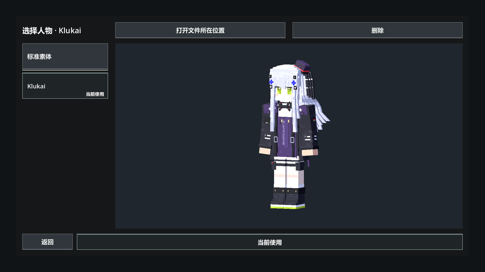

# 人物菜单控件与状态验证

日期：2026-09-27；Godot 4.7 stable，Windows D3D12 Forward+。当前 ASTRAEON 编辑器定向刷新脚本后执行独立图形测试，未启动额外编辑器或冷导入。

`test/ui/gdscript/character_select_check.gd`：**58 checks, 0 failures**，退出码 0，最终日志无 SCRIPT ERROR / ERROR:。命令为 `Godot --path <项目> --fixed-fps 60 --resolution 1920x1080 --script res://test/ui/gdscript/character_select_check.gd`。任务进程 PID 22916，启动于 2026-09-27T02:50:55Z；临时日志与身份记录位于 tmp/character_controls_final.log、tmp/character_controls_final_process.json。

覆盖：名字直接作为按钮、当前使用角标、底部按下状态、预览与保存区分、当前使用按钮幂等、保存后留页并更新状态、重新打开恢复选择、顶部动作边界、滚轮、取消、隔离玩家读取与已有玩家不被替换。布局覆盖 1920×1080、2560×1440、3840×2160、3440×1440；已查看最终 1080p 截图。

删除按从本地列表移除实现：验证删除当前项时保存剩余项，删除未使用项保留当前项、最后一项拒绝删除、重新打开保持删除记录、保留模型文件及其他配置、已移除项不能再选、不同配置互不影响、无效当前设置拒绝删除。全部使用 tmp 下隔离配置，没有删除用户人物或文件。

打开文件夹检查了游戏侧资产目录的解析与可用按钮状态，实际调用使用 OS.shell_open；自动测试不打开桌面资源管理器，因此外部窗口出现与系统关联行为仍属人工验收。打包后没有实体文件夹时该按钮禁用。

只修改菜单与人物目录配置，人物动画与碰撞未改；此前实体运动和原生世界通过结果见 [初始接入](2026-09-27_character_selection.md)，不是本次重跑结果。

