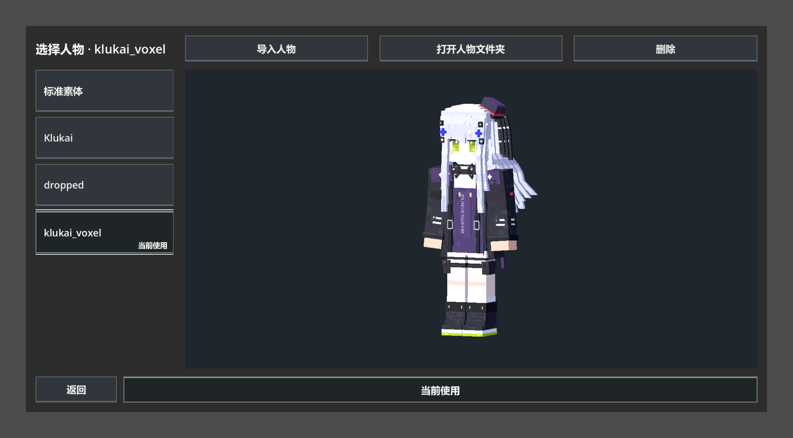

# 外部人物导入轻量验收

日期：2026-09-27。Godot 4.7 stable / Windows D3D12 Forward+。按用户要求仅执行一个简单图形烟测，不重跑完整实体、世界或分辨率矩阵。

入口 `test/ui/gdscript/character_import_smoke.gd`；命令 `Godot --path <项目> --fixed-fps 60 --resolution 1920x1080 --script res://test/ui/gdscript/character_import_smoke.gd`。

最终输出 **CHARACTER_IMPORT_SMOKE checks=9 failures=0**，exit=0，无 SCRIPT ERROR / ERROR:。PID 15336，2026-09-27T09:10:43Z 启动；身份记录与日志在 tmp/character_import_final_process.json、tmp/character_import_final.log。

检查实际用户目录创建；将素体 GLB 放入隔离目录后菜单发现；调用与文件选择器相同的导入处理加载 Klukai；Idle 播放和循环标志；保存选择；玩家实例具有外部模型 ID 与 67 骨骼；删除仅移除用户目录副本；无效 GLB 显示错误且不入列表。导入测试只使用 tmp/character_import_* 下的文件及配置，没有修改用户选择或来源资产。已查看导入后的预览截图。

用户目录已创建：`C:/Users/81010/AppData/Roaming/Godot/app_userdata/ASTRAEON/characters`。实际用户目录保持为空，由用户自行导入。

早期测试脚本直接赋值预加载 Script 的静态目录字段产生解析错误，改用显式 set_directory 清理缓存并切换测试目录后通过。最终生产目录不受测试覆盖。

边界：没有测试任意第三方骨架、打包导出、全部动作的艺术效果或大量模型导入耗时。外部文件选择器通过信号连接相同处理入口，本次未自动操作桌面文件选择窗口。既有大范围人物菜单测试已更新目录约定及隔离方式，但未重跑。

