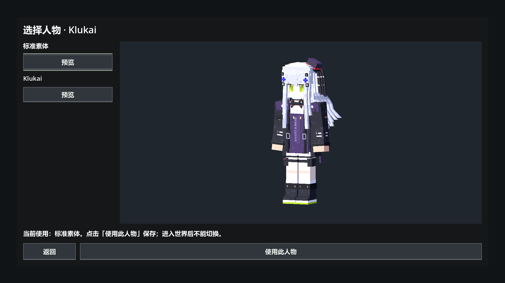

# 人物选择与 Klukai 接入验证

日期：2026-09-27。Godot 4.7 stable / Windows / D3D12 Forward+，RTX 3060 Laptop GPU。使用已连接且确认 ASTRAEON 的编辑器完成导入，独立任务测试进程执行回归，没有另开编辑器或冷导入。按固定 60 FPS 驱动测试，不作为性能数据。

## 本次结果

| 检查 | 结果 |
|---|---|
| character_select_check.gd | 30 checks, 0 failures |
| test_player.gd，标准素体 | 73 checks, 0 failures |
| test_player.gd，`-- klukai` | 73 checks, 0 failures |
| test_world_player.gd，`-- klukai` | failures=0 |
| 主菜单既有 main_menu_check.tscn | 102 checks, 0 failures |

所有最终进程 exit=0，日志无 SCRIPT ERROR / ERROR:。菜单用临时 ConfigFile，世界使用 tmp/first_person_entity_world，不更改用户选择或用户世界。临时日志和进程身份记录位于 tmp/character_select_test、basic_entity_test、klukai_entity_test、klukai_world_recheck、character_home_regression 对应的 .log / _process.json。

人物菜单验证：左下角入口、列表与预览、67 骨骼、六动作、Idle 播放、取消不保存、焦点恢复、保存后创建玩家使用 Klukai、保留其他配置节、已有玩家不随设置变化而换模型。列表当前只有两个条目，测试添加临时溢出项注入滚轮事件验证实际滚动。

人物选择页面检查 1920×1080、2560×1440、3840×2160、3440×1440；边界、按钮和视口断言通过，已查看 1080p、4K 与超宽截图。主菜单另外覆盖 1024×576 和 640×360。截图检查不等同于所有实际显示器的清晰度或玩家手感验收。

实体回归覆盖慢走 0.5141、普通移动 4.3、快跑 5.6 m/s，动画循环和肩部轨道、跳跃/跌落/低顶/斜坡/平台/墙面、第一人称隐藏及第三人称镜头切换。Klukai 在原生世界通过出生地形碰撞、移动、跳跃、落地、相机射线挖掘和保存队列检查。

## 修复与范围

首次 Klukai 导入的袖口小贴图触发 D3D12 压缩纹理创建错误；将 Godot 提取贴图设为无损导入后，重导入及全部图形测试无该错误。GLB 原文件 SHA-256 保持 cb7458b4f1432331258eca222dd322ccefa5839c4a9bba919606a6a87ad963f6。

首次原生世界测试的挖掘断言失败：夹具禁用了 controller.input_enabled，而当前世界交互已要求输入启用。夹具改为仅在发送挖掘事件时启用输入，重跑通过；没有为测试绕过生产输入门控。

本次不包含头发物理、运行时换装或动画打磨。19 主体骨 + 48 头发骨和完整衣物形态轨道保留。

## 重跑

在确认不会与编辑器导入冲突的现有导入状态下，使用项目引擎执行：

```text
Godot --path <项目> --fixed-fps 60 --script res://test/ui/gdscript/character_select_check.gd
Godot --path <项目> --fixed-fps 60 --script res://test/entities/gdscript/test_player.gd
Godot --path <项目> --fixed-fps 60 --script res://test/entities/gdscript/test_player.gd -- klukai
Godot --path <项目> --fixed-fps 60 --script res://test/entities/gdscript/test_world_player.gd -- klukai
```


